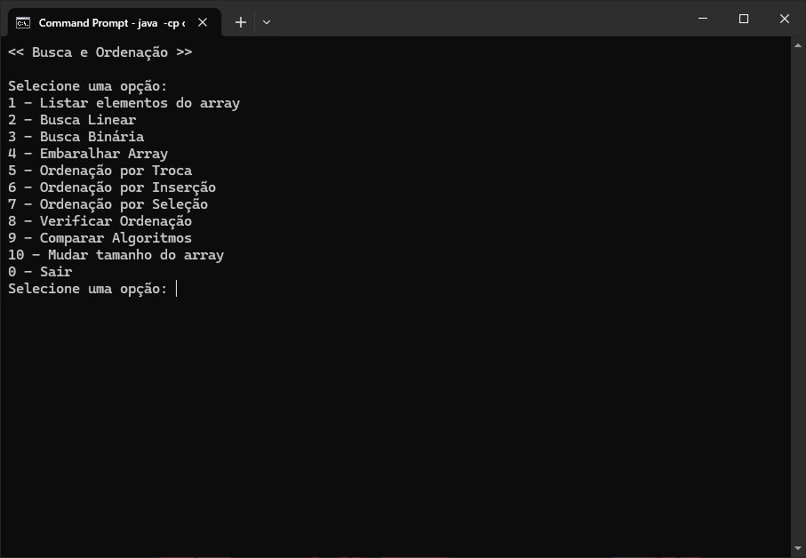
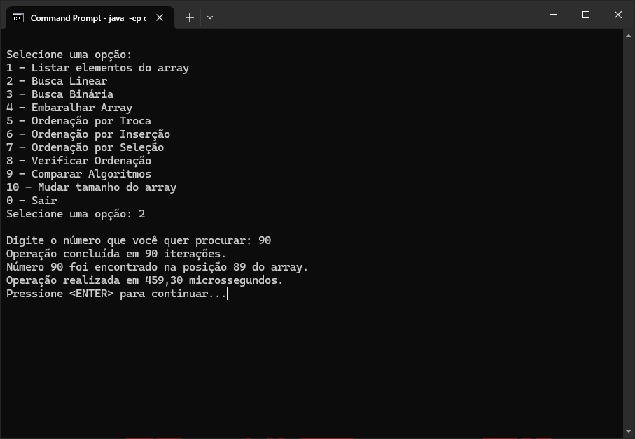
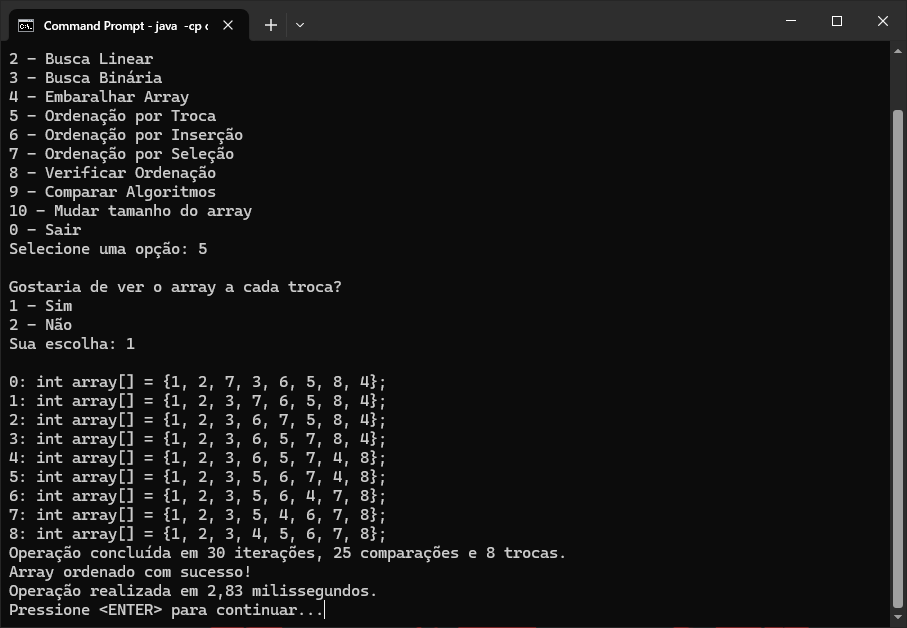
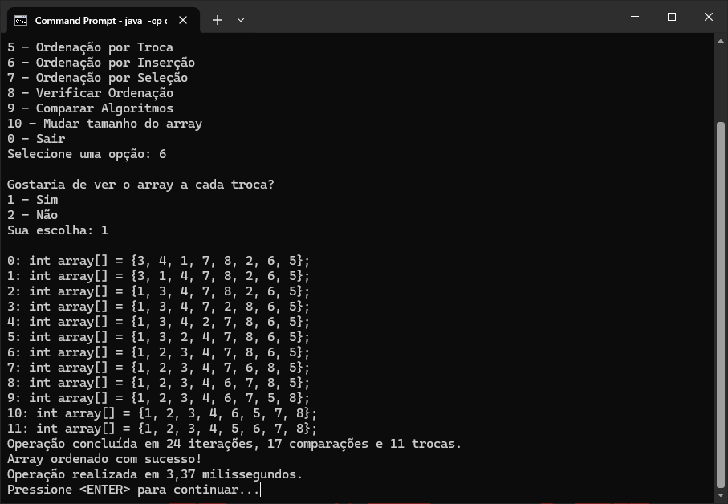
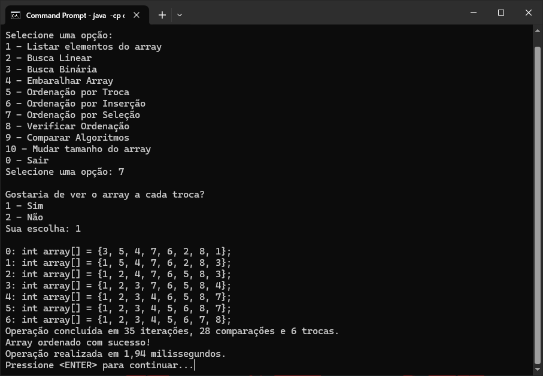
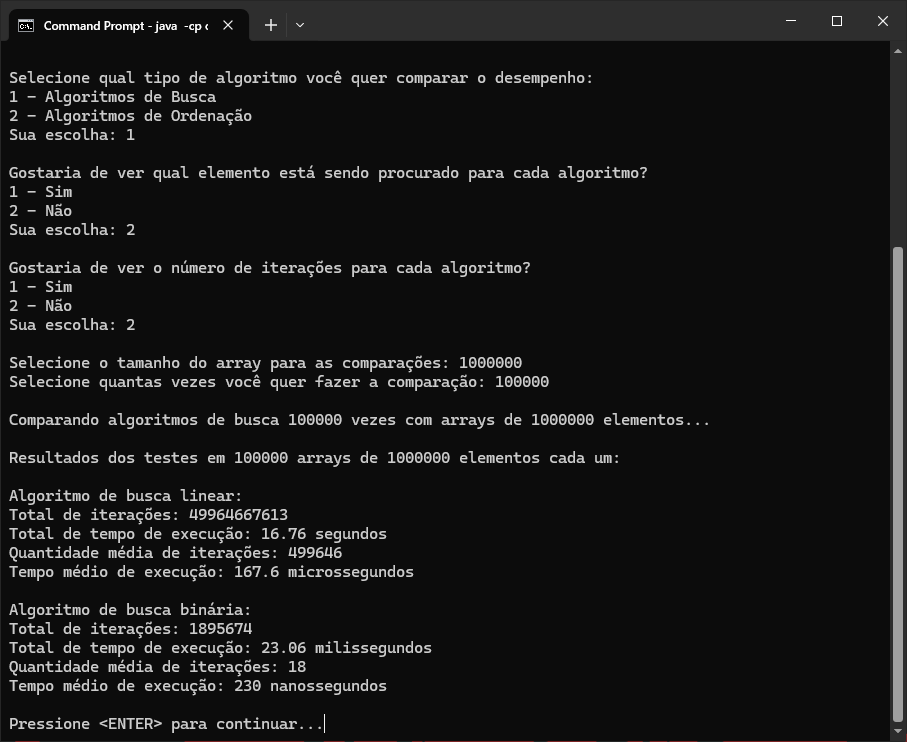
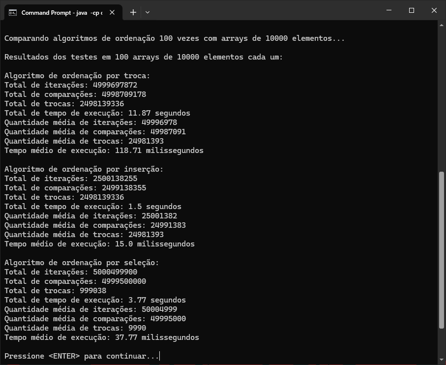

# Algoritmos de Busca e Ordenação em Java

Projeto educativo desenvolvido em Java com o objetivo de estudar, implementar e comparar diferentes algoritmos de busca e ordenação de dados.

A aplicação funciona por meio de um menu interativo no terminal, permitindo executar os algoritmos, visualizar as operações realizadas, verificar a ordenação de um array e analisar o desempenho das implementações.

## Download

Você pode baixar uma versão executável do projeto diretamente pela página de Releases, sem precisar clonar o repositório ou compilar o código-fonte.

**[Acessar Releases e baixar o programa](https://github.com/cdGuilherme/algoritmos-busca-ordenacao/releases)**

### Como executar

1. Baixe o arquivo `algoritmos-busca-ordenacao.jar` na versão desejada.
2. Certifique-se de ter o Java 26 instalado.
3. Abra um terminal na pasta onde o arquivo foi baixado.
4. Execute:

```bash
java -jar algoritmos-busca-ordenacao.jar
```

O programa será iniciado diretamente no terminal.

## Funcionalidades

### Algoritmos de busca
- Busca Linear.
- Busca Binária.

### Algoritmos de ordenação
- Ordenação por Troca (Bubble Sort).
- Ordenação por Inserção (Insertion Sort).
- Ordenação por Seleção (Selection Sort).

### Manipulação de dados
- Embaralhamento de array utilizando o algoritmo Fisher-Yates.
- Alteração do tamanho do array principal para realização de testes.
- Visualização dos elementos do array.
- Verificação se o array está ordenado.

### Análise de desempenho
- Contagem de iterações, comparações e trocas.
- Medição do tempo de execução.
- Comparação de desempenho entre os algoritmos de busca.
- Comparação de desempenho entre os algoritmos de ordenação.

## Demonstração

A seguir, alguns exemplos da aplicação em funcionamento.

### Menu principal



### Algoritmos de busca

Demonstração da execução da Busca Linear e da Busca Binária.

**Busca Linear**



**Busca Binária**


### Algoritmos de ordenação

Os algoritmos de ordenação possuem visualização das operações realizadas durante sua execução, permitindo acompanhar as trocas e movimentações dos elementos no array.

**Ordenação por Troca (Bubble Sort)**



**Ordenação por Inserção (Insertion Sort)**



**Ordenação por Seleção (Selection Sort)**



### Comparação de algoritmos de busca

Comparação entre Busca Linear e Busca Binária, permitindo analisar suas diferenças de desempenho.



### Comparação de algoritmos de ordenação

Comparação entre os algoritmos de Ordenação por Troca, Inserção e Seleção, utilizando as métricas de desempenho implementadas.



## Tecnologias utilizadas

- **Java 26** — linguagem de programação utilizada no desenvolvimento.
- **Git e GitHub** — controle de versão e hospedagem do código.
- **IntelliJ IDEA** — ambiente de desenvolvimento utilizado.

## Como executar o projeto

### Pré-requisitos

Antes de começar, você precisará ter instalado:

- [JDK 26](https://www.oracle.com/java/technologies/downloads/).
- [Git](https://git-scm.com/downloads).

Para verificar se o Java e o compilador estão instalados corretamente, execute no terminal:

```bash
java -version
javac -version
```

Ambos devem indicar a versão 26.

### 1. Clonar o repositório

Abra o terminal e execute:

```bash
git clone https://github.com/cdGuilherme/algoritmos-busca-ordenacao.git
```

### 2. Acessar a pasta do projeto

```bash
cd algoritmos-busca-ordenacao
```

### 3. Compilar o projeto

Na pasta raiz do projeto, execute:

```bash
javac -d out src/*.java
```

Esse comando compila os arquivos `.java` presentes na pasta `src/` e direciona os arquivos compilados para a pasta `out/`.

Caso a pasta `out/` ainda não exista, o compilador a criará automaticamente.

### 4. Executar o programa

Após a compilação, execute:

```bash
java -cp out Main
```

A aplicação será iniciada no terminal e apresentará o menu interativo com as opções disponíveis.

> **Observação:** Os comandos consideram que as classes estão no pacote padrão, sem declarações `package`. A pasta `src/META-INF/` não precisa ser incluída na compilação dos arquivos Java.

## Opções disponíveis

Ao iniciar a aplicação, o usuário encontrará as seguintes opções:

| Opção | Funcionalidade |
|:---:|---|
| 1 | Listar elementos do array |
| 2 | Executar Busca Linear |
| 3 | Executar Busca Binária |
| 4 | Embaralhar Array |
| 5 | Executar Ordenação por Troca |
| 6 | Executar Ordenação por Inserção |
| 7 | Executar Ordenação por Seleção |
| 8 | Verificar Ordenação |
| 9 | Comparar Algoritmos |
| 0 | Sair do programa |

## Análise de desempenho

O projeto possui duas funcionalidades independentes para comparação de desempenho.

### Comparação de algoritmos de busca

Compara a Busca Linear e a Busca Binária, permitindo observar as diferenças entre suas implementações e analisar métricas como iterações e tempo de execução.

### Comparação de algoritmos de ordenação

Compara os algoritmos de Ordenação por Troca, Inserção e Seleção, permitindo analisar o comportamento e a eficiência de cada implementação.

## Objetivos de aprendizagem

Este projeto tem como propósito consolidar conhecimentos de lógica de programação e estruturas básicas de dados, explorando principalmente:

- Funcionamento e implementação de algoritmos de busca.
- Diferentes estratégias de ordenação de dados.
- Manipulação de arrays.
- Estruturas de repetição e controle de fluxo.
- Análise de desempenho e comparação entre algoritmos.
- Medição de tempo de execução e contagem de operações.

O projeto também serve como base para estudos futuros sobre complexidade de algoritmos e análise de eficiência computacional.